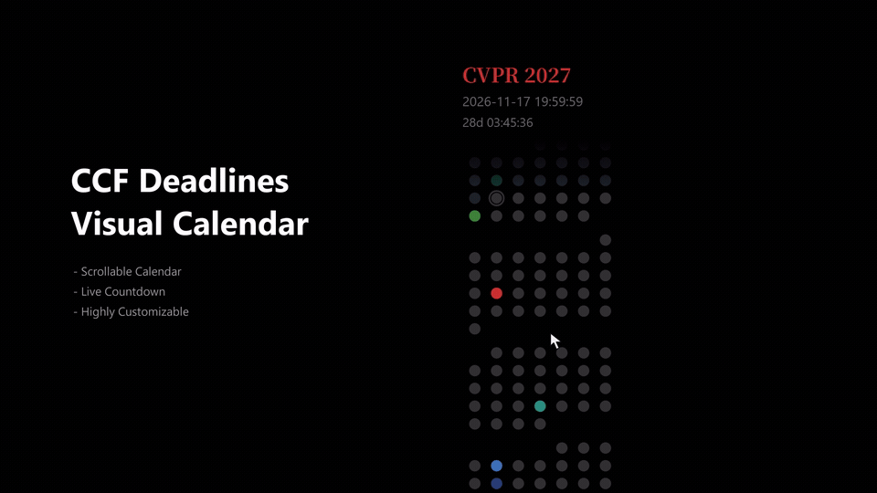

# CCF Deadlines Visual Calendar

English | [简体中文](README-CN.md)

A neat, elegant and customizable Windows desktop calendar for keeping track of CCF conference deadlines.

[](assets/ccf-calendar-demo.mp4)

## Features

- 📅 **Scrollable dot calendar** with deadline details on hover.
- ⏳ **Live deadline countdown**, with the option to pin your target conference.
- 🎨 **Highly customizable** colors, fonts, window size, and transparency.
- 🌍 **Selectable time zone** for all displayed deadlines.
- 🔄 **Automatic daily updates** with offline access to cached data.

## Quickstart

**Download:** Get `DeadlineCalendar-win-x64.zip` from this repository's **Releases** page, extract the entire archive, and run `DeadlineCalendar.exe`.

Right-click the calendar icon in the **Windows system tray** to hide, show, quit, or open **Settings**, where you can select concerned conferences, customize your own appearances, etc.

**From Source:** Download or clone the repository, install the .NET SDK listed below, and run this command from the repository root:

```powershell
dotnet run --project src/DeadlineCalendar.App/DeadlineCalendar.App.csproj -c Release
```

## Requirements

- Windows 11 x64.
- Internet access to fetch and refresh conference data from [CCF Deadlines](https://github.com/ccfddl/ccf-deadlines); cached data remains available offline.
- [.NET 10 SDK](https://dotnet.microsoft.com/download/dotnet/10.0), version 10.0.402 or a newer 10.0 SDK feature band, for source builds only.
